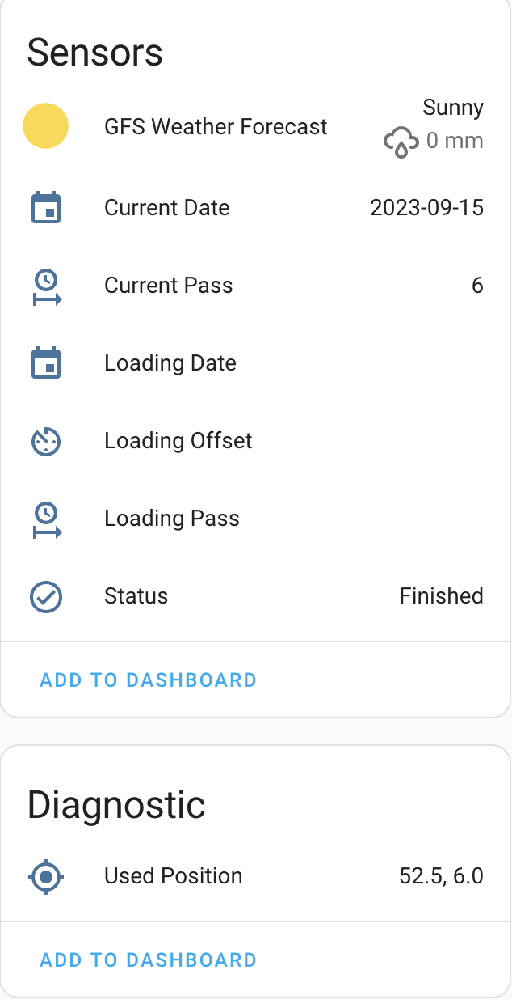

# GFS Weather Forecast

This is a custom integration of the GFS Weather Forecast. It will provide a weather entity based on the information gathered with the GFS Weather Forecast addon.

## Installation

First make sure you installed the GFS Weather Forecast addon, see https://github.com/MarcoGos/addon-gfs_weather_forecast. After the addon is running you can install this integration.

Via HACS:

[](https://my.home-assistant.io/redirect/hacs_repository/?owner=MarcoGos&repository=gfs_weather_forecast&category=integration)

<details>
<summary>Add the repository manually</summary>

1. Open **HACS** in Home Assistant.
2. Open the three-dot menu in the top-right corner and select **Custom repositories**.
3. Enter `https://github.com/MarcoGos/gfs_weather_forecast` as the repository URL.
4. Select **Integration** as the type and click **Add**.

</details>

After adding the repository using either method:

1. Find **GFS Weather Forecast** in HACS and download it.
2. Restart Home Assistant.
3. Go to **Settings > Devices & services > Add integration** and search for **GFS Weather Forecast**.

## Setup

During the setup of the integration the api port of the addon needs to be provided, the default port is 8765.

## What to expect

The following sensors will be registered:



The sensor information is updated every 4 hours.

## Custom dashboard card

Use the [GFS Weather Card](https://github.com/MarcoGos/gfs-weather-card) to display
this integration's forecast data as a horizontally scrollable table on your
Home Assistant dashboard. The card connects directly to the integration through
Home Assistant; no separate forecast URL or CORS configuration is needed.
See the card's repository for installation and configuration instructions.

## Full forecast for dashboard cards

The integration also retrieves the add-on's complete `/api/latest` JSON, including
`info` and all forecast-hour fields. It caches this in Home Assistant at startup
and when the status reports a newly finished forecast run. Status is checked every
15 seconds; card requests read the cache without contacting the add-on.

Authenticated dashboard cards can retrieve the original JSON over Home Assistant's
WebSocket connection:

```javascript
const forecast = await this.hass.callWS({
    type: "gfs_weather_forecast/get_forecast",
});
```

With multiple configured integration entries, include `entry_id` to select one:

```javascript
const forecast = await this.hass.callWS({
    type: "gfs_weather_forecast/get_forecast",
    entry_id: "YOUR_CONFIG_ENTRY_ID",
});
```

The result has the same structure as the add-on's JSON file. No public file URL,
browser access to the add-on, CORS configuration, or large entity attributes are
needed.

If an update fails, the last successful JSON remains available and the integration
retries on the next status poll. Command errors use `not_loaded` for missing or
unloaded entries, `entry_required` for ambiguous selection, and `not_ready` when
no forecast has been cached yet. Unloading an entry removes access to its cache.
